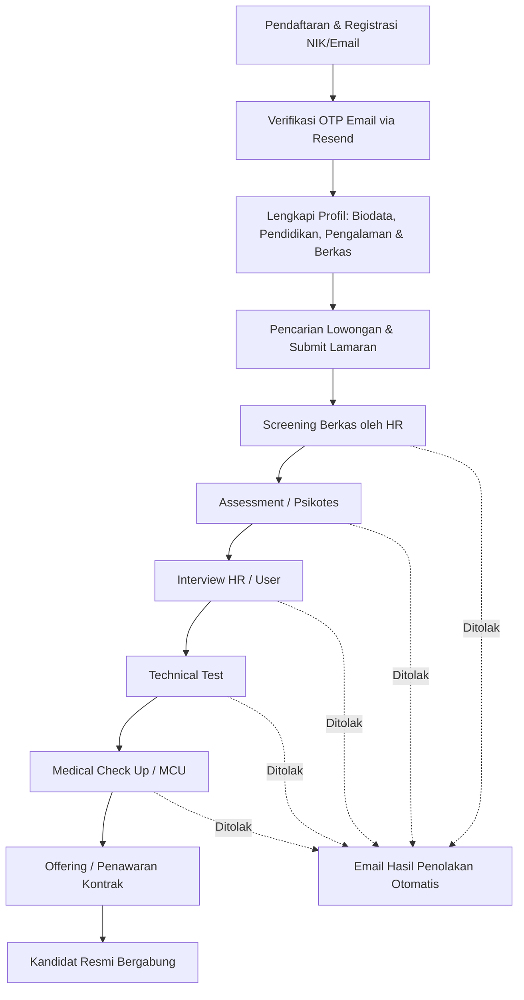

# SIO Karir - Career Portal PT Pupuk Kujang Cikampek


**SIO Karir** adalah platform portal karir dan sistem rekrutmen daring (*e-recruitment system*) resmi untuk **PT Pupuk Kujang Cikampek (PKC)**. Platform ini dirancang untuk mempermudah pencarian talenta terbaik, mengotomasi alur seleksi bertahap, memfasilitasi pelamar dalam melengkapi profil dan dokumen pendukung, serta menyediakan dashboard komprehensif bagi tim Human Resources (HR).

---

## 📑 Daftar Isi

- [Fitur Utama](#-fitur-utama)
  - [1. Portal Publik & Pelamar Umum](#1-portal-publik--pelamar-umum)
  - [2. Portal Kandidat (Job Seeker)](#2-portal-kandidat-job-seeker)
  - [3. Portal HR & Rekrutmen (Recruiter / Admin)](#3-portal-hr--rekrutmen-recruiter--admin)
- [Teknologi yang Digunakan](#-teknologi-yang-digunakan)
- [Struktur Direktori Proyek](#-struktur-direktori-proyek)
- [Panduan Instalasi & Menjalankan](#-panduan-instalasi--menjalankan)
  - [Prasyarat](#prasyarat)
  - [Langkah Pemasangan](#langkah-pemasangan)
  - [Variabel Lingkungan (.env)](#variabel-lingkungan-env)
  - [Migrasi & Seed Database](#migrasi--seed-database)
  - [Menjalankan Server Lokal](#menjalankan-server-lokal)
- [Akun Uji Coba Default (Seeder)](#-akun-uji-coba-default-seeder)
- [Alur Seleksi Kandidat](#-alur-seleksi-kandidat)

---

## 🌟 Fitur Utama

### 1. Portal Publik & Pelamar Umum
- **Landing Page Interaktif**: Menampilkan informasi seputar PT Pupuk Kujang, pengenalan nilai-nilai budaya perusahaan (**AKHLAK** - Amanah, Kompeten, Harmonis, Loyal, Adaptif, Kolaboratif), serta lowongan terbaru.
- **Pencarian & Filter Lowongan**: Pencarian cepat lowongan pekerjaan berdasarkan kata kunci posisi, departemen, dan lokasi.
- **Registrasi & Verifikasi OTP**: Pendaftaran akun menggunakan NIK unik dan verifikasi email satu kali pakai (OTP) via Resend.
- **Autentikasi Aman**: Login berbasis peran (*Role-Based Access Control* - `KANDIDAT` dan `HR`) dengan password terenkripsi bcrypt.

### 2. Portal Kandidat (Job Seeker)
- **Manajemen Profil Mandiri**:
  - Biodata personal lengkap dan alamat/domisili terstruktur (Provinsi, Kabupaten, Kecamatan, Desa/Kelurahan, RT/RW, Kode Pos).
  - Riwayat Pendidikan (jenjang, institusi, jurusan, tahun, IPK) disertai unggah berkas Ijazah.
  - Riwayat Pengalaman Kerja disertai unggah surat keterangan kerja / Paklaring.
  - Riwayat Sertifikasi keahlian profesional disertai unggah sertifikat.
- **Manajemen Berkas Kandidat**: Unggah dan kelola CV, KTP, Ijazah, Transkrip nilai, dan dokumen pendukung lainnya.
- **Pengajuan Lamaran Terpadu**: Melamar lowongan dengan validasi persyaratan, termasuk **filter domisili desa binaan** jika posisi diprioritaskan bagi warga lokal sekitar kawasan industri PT Pupuk Kujang.
- **Pelacakan Status Lamaran Real-Time**: Visualisasi tahapan seleksi (*stepper*) dari status awal hingga penerimaan:
  `Screening` ➔ `Assessment` ➔ `Interview` ➔ `Technical Test` ➔ `MCU` ➔ `Offering`.
- **Detail Undangan Seleksi**: Akses detail jadwal tanggal, waktu, lokasi, dan instruksi teknis tes/interview.

### 3. Portal HR & Rekrutmen (Recruiter / Admin)
- **Dashboard Ringkasan & Statistik**:
  - Metrik statistik lowongan aktif, total pelamar baru, pelamar yang sedang diproses, dan lowongan kadaluarsa.
  - Sebaran kandidat di setiap tahapan seleksi.
  - Filter rentang periode (hari ini, minggu ini, bulan ini, atau semua).
- **Kelola Lowongan Pekerjaan**:
  - Buat, ubah status (`DRAFT`, `AKTIF`, `DITUTUP`), perbarui kriteria gaji, batas waktu pendaftaran, dan tanggung jawab pekerjaan.
  - Kustomisasi tahapan seleksi dinamis per lowongan.
  - Konfigurasi proteksi domisili (pembatasan pelamar khusus desa binaan tertentu).
- **Manajemen & Seleksi Kandidat**:
  - Daftar pelamar per lowongan dengan penyaringan status dan tahapan.
  - Tinjau profil komprehensif pelamar, histori pendidikan, pengalaman, dan berkas (CV/ijazah).
  - Pindah tahapan seleksi kandidat atau tolak lamaran secara fleksibel.
  - Penjadwalan tes/wawancara dengan modal input tanggal, waktu, lokasi, dan catatan khusus.
- **Otomasi Notifikasi Email & Log**:
  - Pengiriman email otomatis untuk surat undangan seleksi, pengumuman lolos, maupun pemberitahuan belum sesuai kualifikasi.
  - Fitur kirim pesan bebas (*custom email*) ke kandidat terpilih.
  - Riwayat & audit log email terkirim/gagal (`EmailLog`).

---

## 🛠 Teknologi yang Digunakan

| Kategori | Teknologi | Deskripsi |
| :--- | :--- | :--- |
| **Framework** | [Next.js 16](https://nextjs.org/) (App Router) | Framework React modern untuk frontend & backend API route |
| **Bahasa** | [TypeScript](https://www.typescriptlang.org/) | Type-safety untuk kestabilan kode |
| **UI Library** | [React 19](https://react.dev/) | Library UI komponen |
| **Styling** | [Tailwind CSS v4](https://tailwindcss.com/) | Utilitas styling modern dan responsif |
| **Komponen & Ikon** | [Lucide React](https://lucide.dev/), `@base-ui/react` | Ikonografi dan primitives komponen |
| **Database & ORM** | [PostgreSQL](https://www.postgresql.org/) & [Prisma ORM 7](https://www.prisma.io/) | Database relasional dengan skema terstruktur |
| **Driver Adapter** | `@prisma/adapter-pg` & `pg` | Driver pool adapter PostgreSQL untuk Prisma |
| **Email Gateway** | [Resend](https://resend.com/) | Pengiriman email transaksional & verifikasi OTP |
| **Keamanan** | `bcryptjs` | Hashing password pengguna |
| **Dokumen** | `pdf-lib` | Manipulasi dan pengelolaan file dokumen PDF |

---

## 📁 Struktur Direktori Proyek

```text
jobportal-pupuk-kujang/
├── app/
│   ├── (public)/              # Halaman publik (Beranda / landing page, lowongan)
│   ├── api/                   # API Routes (Auth, lowongan, lamaran, profile, email OTP)
│   ├── components/            # Komponen khusus halaman (Navbar, TahapanStepper, Modals)
│   ├── hr/                    # Dashboard dan modul portal HR
│   │   ├── daftarkandidat/    # Peninjauan dan seleksi berkas kandidat
│   │   ├── kelolalowongan/    # Form CRUD lowongan pekerjaan
│   │   ├── lowongan/          # Detail lowongan dari sisi HR
│   │   └── profile/           # Profil akun HR
│   ├── kandidat/              # Portal pelamar (Dashboard, profil, lamaran saya)
│   │   ├── lamaran/           # Status & riwayat lamaran pelamar
│   │   ├── lowongan/          # Eksplorasi & submit lamaran
│   │   └── profil/            # Form biodata, pendidikan, pengalaman, berkas
│   ├── login/                 # Halaman autentikasi masuk
│   ├── register/              # Halaman pendaftaran kandidat
│   ├── verify-email/          # Halaman verifikasi kode OTP email
│   ├── globals.css            # Styling global Tailwind CSS
│   └── layout.tsx             # Root layout aplikasi
├── components/                # Komponen UI umum (misal: UI Scroll Area)
├── lib/                       # Utilitas bersama (Prisma client, helper email, format date/currency)
├── prisma/                    # Konfigurasi database Prisma
│   ├── migrations/            # Histori migrasi PostgreSQL
│   ├── schema.prisma          # Skema model & relasi database
│   └── seed.ts                # Data awal untuk pengujian
├── public/                    # Aset statis gambar, logo, dan dokumen
├── prisma.config.ts           # Konfigurasi Prisma CLI & runner
└── package.json               # Daftar dependensi dan script eksekusi
```

---

## 🚀 Panduan Instalasi & Menjalankan

### Prasyarat
Pastikan sistem Anda telah terpasang:
- [Node.js](https://nodejs.org/) versi 20 ke atas
- [PostgreSQL](https://www.postgresql.org/) versi 14 ke atas
- Manajer paket `npm` / `pnpm` / `yarn`

### Langkah Pemasangan

1. **Clone repositori dan masuk ke direktori proyek**:
   ```bash
   git clone <URL_REPOSITORY>
   cd jobportal-pupuk-kujang
   ```

2. **Pasang dependensi**:
   ```bash
   npm install
   ```

### Variabel Lingkungan (.env)
Buat atau sesuaikan file `.env` di root direktori dengan format berikut:

```env
# Koneksi Database PostgreSQL
DATABASE_URL="postgresql://<DB_USER>:<DB_PASSWORD>@<DB_HOST>:<DB_PORT>/<DB_NAME>"

# Konfigurasi Email Resend
RESEND_API_KEY="re_xxxxxxxxxxxxxx"
EMAIL_FROM="SIO Karir <onboarding@resend.dev>"
```

### Migrasi & Seed Database

1. **Generate Prisma Client & Migrasi Database**:
   ```bash
   npx prisma migrate dev --name init
   # atau jika migrasi sudah ada:
   npx prisma generate
   ```

2. **Jalankan Seeder Database (Opsional untuk data akun uji coba)**:
   ```bash
   npm run seed
   # atau
   npx prisma db seed
   ```

### Menjalankan Server Lokal

Jalankan server pengembangan:
```bash
npm run dev
```

Buka peramban (*browser*) dan akses aplikasi pada tautan:
**[http://localhost:3000](http://localhost:3000)**

---

## 🔑 Akun Uji Coba Default (Seeder)

Jika Anda telah menjalankan `seed.ts`, akun default berikut dapat digunakan untuk pengujian:

| Peran (Role) | NIK | Email | Password | Hak Akses |
| :--- | :--- | :--- | :--- | :--- |
| **HR / Recruiter** | `3200000000000001` | `hr@gmail.com` | `hr123456` | Dashboard HR, Kelola Lowongan, Seleksi & Email |
| **Kandidat** | `1234567890123456` | `kandidat@gmail.com` | `kandidat123` | Portal Kandidat, Isi Profil & Dokumen, Melamar Pekerjaan |

---

## 🔄 Alur Seleksi Rekrutmen



---

## 📄 Lisensi & Hak Cipta

Proyek ini dikembangkan untuk kebutuhan operasional rekrutmen dan rekayasa sistem informasi di lingkungan **PT Pupuk Kujang Cikampek**. Seluruh aset grafis, merek dagang, dan data perusahaan merupakan hak milik PT Pupuk Kujang.
